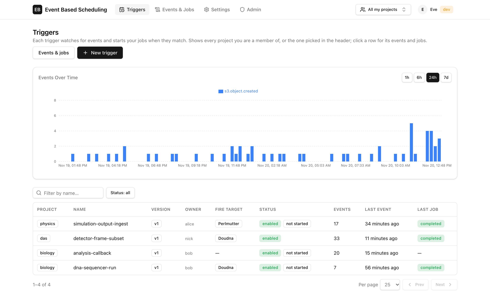
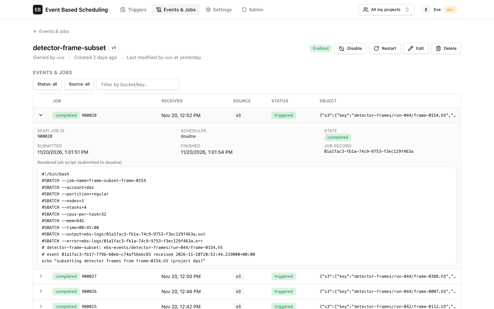

# ebs-cli

`ebs` is a command-line client for NERSC Event Based Scheduling. It discovers your Projects, lists and controls triggers, shows events with their jobs, and runs direct S3 object commands against a trigger's bucket using temporary, operation-scoped access.

**Try the web interface at <https://ebs-poc.nersc.gov>**. It shows the same Projects, triggers, events, and jobs, and it is where you create your personal API token.





## Quick start

Python 3.11 or newer is required. `uv` installs a managed Python if the current one is too old.

```sh
git clone https://github.com/tylern4/ebs-cli.git
cd ebs-cli
uv sync
source .venv/bin/activate
```

Log in through Globus in your browser:

```sh
ebs auth login
```

On a machine without a browser (for example, over SSH), use `ebs auth login --no-browser` instead: open the displayed URL anywhere, and paste the one-time code into the hidden prompt. For automation or a token created in the web interface, use `ebs auth login --token` and paste it at the hidden prompt. See [Authentication and Projects](docs/authentication.md) for all login options.

Personal tokens expire after 48 hours. With a saved browser login, the CLI renews the token automatically the next time you run a command; use `ebs auth refresh` to rotate it early and `ebs auth logout` to log out. A token supplied with `--token` or `EBS_TOKEN` is not renewed this way — log in again when it expires.

## Pick a Project and run your first commands

List your Projects and save a default, using the exact name from the list. The listing also shows a `Triggers` count per Project (`trigger_count` with `--json`), so you can see which Projects have triggers configured:

```sh
ebs projects list
ebs projects use PROJECT
```

After this, plain commands work without flags or environment variables:

```sh
ebs triggers list
ebs triggers show TRIGGER
ebs events list TRIGGER
ebs s3 ls TRIGGER --prefix run/
```

`TRIGGER` is a trigger's ID (UUID) or its exact name in the selected Project. To upload a local file straight to a trigger's bucket:

```sh
ebs s3 upload TRIGGER ./data.fits
```

## Guides

| Guide | Contents |
| --- | --- |
| [FITS pipeline with the web interface](docs/fits-starfinder-web-ui.md) | Upload FITS files and process them with a mock `starfinder` batch-job trigger |
| [FITS pipeline with the CLI](docs/fits-starfinder-cli.md) | The same mock star-finding workflow with YAML trigger documents and `ebs` commands |
| [Web interface](docs/web-interface.md) | Signing in, Projects, tokens, triggers, events, and upload access in the browser |
| [Authentication and Projects](docs/authentication.md) | Login options, token refresh and logout, and choosing a Project |
| [Triggers and events](docs/triggers.md) | Listing, filtering, pagination, trigger references |
| [S3 operations and boto3](docs/s3.md) | Scoped temporary credentials, object commands, uploads, presigned URLs |
| [Development and CI](docs/development.md) | For contributors: tests, linting, builds, and continuous integration |

## Handling credentials safely

The CLI uses personal EBS API tokens. It never asks for the object store's root key or system credentials, and it keeps your EBS token and S3 credentials out of each other's requests. Keep tokens and temporary S3 credentials out of logs, scripts, and shell history:

- `ebs s3 credentials` prints the temporary access key, secret key, and session token to stdout. Protect that output and shared terminals.
- The direct S3 commands (`s3 ls`, `s3 download`, `s3 rm`, `s3 upload`) do not display temporary credentials, and signed URLs stay redacted unless you pass `--show-url`.
