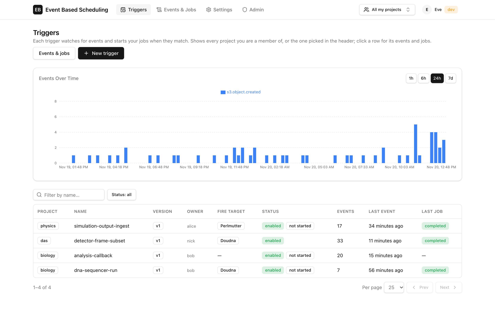
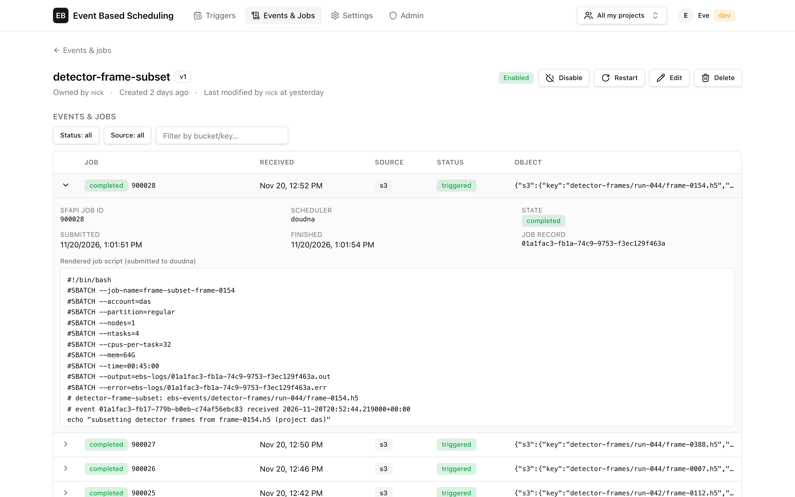

# Using the web interface

Return to the [guide index](index.md).

The EBS web interface at <https://ebs-poc.nersc.gov> covers the same ground as the CLI. This guide walks its main workflows; the CLI guides cover the command-line equivalents.

## Sign in

Open the site and use the single sign-in button on the login page. Sign-in uses your NERSC identity, and your Project memberships are synchronized when you log in. After signing in you land on the triggers view; everything else lives behind the navigation in the app header.

## Choose a Project

A selector in the app header picks the Project you are working in. It lists the Projects you belong to, with your role in each, and defaults to an aggregate view across all of your Projects. The selected Project scopes every page: the trigger table, the events views, and the create form all operate inside it. The CLI equivalent is saving a default Project with `ebs projects use` (see [Authentication and Projects](authentication.md)).

## Create a personal token for the CLI

The Settings page has an **API tokens** section for the personal tokens that scripts and the CLI use.

1. Enter a token name that reminds you what it is for, such as "laptop cron job", and choose **Create token**.
2. The full token is shown once, in a copyable banner. Store it in your password manager or script before leaving the page; only a hash is kept, so it can never be displayed again.
3. The list below shows each token's name, creation time, last-used time, and state (Active or Revoked). Revoke a token with its inline confirmation when you no longer need it.

Then run `ebs auth login --token` in a terminal and paste the token at the hidden prompt (see [Authentication and Projects](authentication.md)). The Settings page also stores your personal job-submission credentials for triggers that fire on your behalf; that section is unrelated to CLI login.

## Create and manage triggers

The Triggers page is a table of the selected Project's triggers with sorting, filtering, and pagination in the page address, plus a chart of event volume over the last hour, six hours, day, or week.

Who can change what is role-aware: members with the maintainer or admin role manage every trigger in the Project, ordinary members manage only the triggers they created, and staff have read-only access everywhere.

To create a trigger, use the create button. Its four steps are Template, Inputs, Outputs, then Test/Verify. You name the trigger, pick its input kind (bucket events from S3, or scheduler job events), choose the output (a job script to start, or a callback URL), and test the configuration against a sample event derived from your matchers before saving. A provisioned bucket for the selected Project is suggested wherever a bucket is asked for.

Click a trigger row to manage it. The detail page lets you edit the configuration, enable or disable the trigger, restart its background service, deploy it explicitly if it is enabled but not yet deployed, or delete it after confirmation. The page also shows the trigger's read-only pipeline details and service status.

On the command line these correspond to `ebs triggers list`, `show`, `enable`, and `disable` (see [Triggers and events](triggers.md)).

## View events and jobs

The **Events & jobs** page lists the Project's triggers as a picker, because events belong to triggers. Choosing one opens its event and job table: each event with the job it started, the job status, and a bounded failure reason. A live event stream is also embedded in the trigger detail page. This mirrors `ebs events list` (see [Triggers and events](triggers.md)).

## S3 upload access

On the detail page of an S3 trigger that you may manage, an upload-data section offers two short-lived, upload-only grants for the trigger's bucket:

- **Presigned upload link**: a PUT URL for one object key, valid until it expires. The signed URL is masked until you explicitly reveal it.
- **Temporary credentials**: an access key, secret key, and session token for any S3 client, with lifetimes of 15 or 30 minutes or 1 hour.

Secret values on this page stay masked until you reveal them, are held only in the page until you discard them or navigate away, and are never shown again after that. The page also shows ready-to-copy CLI commands for the same operations, carrying the selected Project and this trigger's identifier. For anything beyond a one-off upload, prefer the CLI (see [S3 operations and boto3](s3.md)): it handles temporary credentials for you and keeps them out of the browser.
